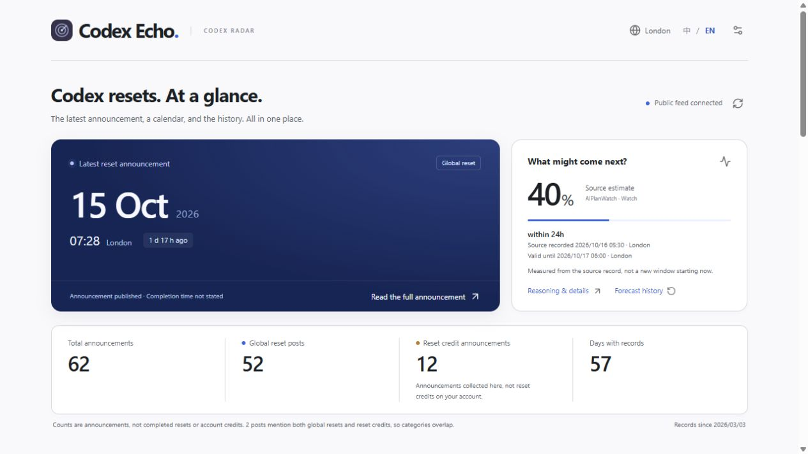
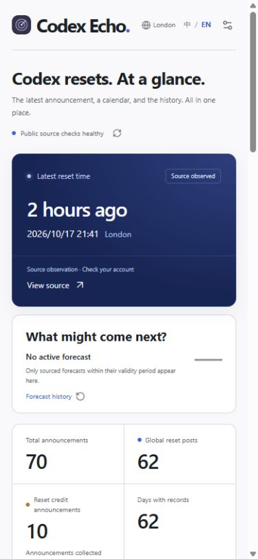
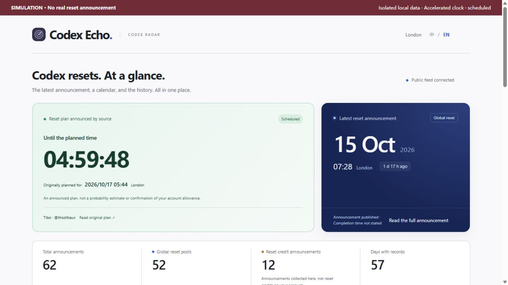
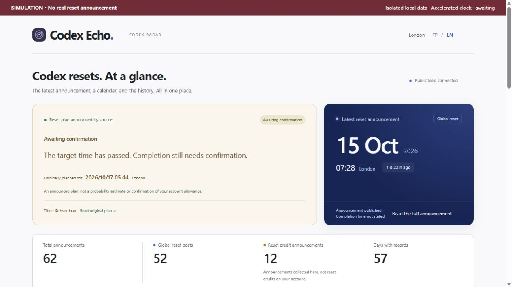
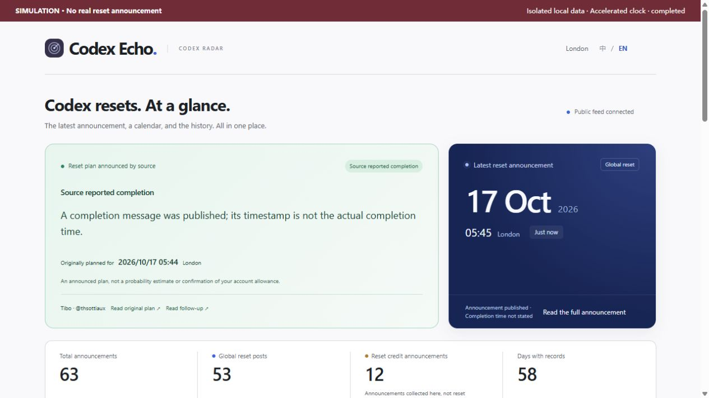
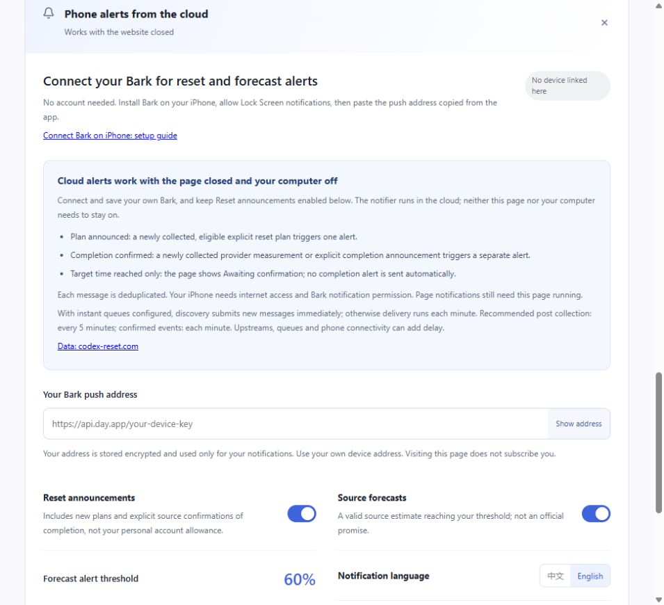

# Codex Echo · Codex 回响

[简体中文](README.md) | **English**

A simple **Codex reset announcement and forecast radar**: the latest announcement, a history calendar, collected Tibo posts and **Bark notifications on your iPhone Lock Screen**.

**[Open the website](https://echo-radar.pages.dev/) · [Connect Bark on iPhone](docs/BARK_SETUP.en.md)**

The old long website address automatically redirects to the short URL above, preserving post and forecast links. Cloud Bark subscriptions and alerts continue. If you connected only on the old domain, the short website may show no linked device; paste the same Bark address to restore management without unsubscribing first.

## Website preview

These are screenshots of the public website. Dates, counts and forecasts are snapshots; visit the website for current values.



<details>
<summary>View the mobile layout</summary>



</details>

<details>
<summary>View the lifecycle: announced → awaiting → completed (synthetic data)</summary>

**This is a local simulation, not a real announcement or a claim that a reset is currently five hours away.** A precise source announcement activates the countdown alongside the latest historical post. All screenshots use the English interface; the clock is accelerated and production data is unchanged.

**1. Plan announced:** the countdown appears; the plan is excluded from historical announcement counts.



**2. Awaiting confirmation:** reaching the target does not confirm completion or send a completion alert.



**3. Source reported completion:** a new explicit completion updates the card and triggers a separate alert. The extra historical entry exists only in this local simulation.



</details>

## Recommended: connect Bark on the website

1. Install **Bark** on your iPhone and allow Lock Screen notifications.
2. Copy your push address from Bark.
3. Open the website, scroll to **Phone alerts from the cloud**, paste the address, choose alert types, threshold and language, then **Connect and save**.
4. Send a test notification, close the website and lock your phone to verify receipt.

No GitHub account, code download or purchased server is needed. The full guide covers each step, saving, unsubscribing and troubleshooting messages visible inside Bark but absent from the Lock Screen.

**After connecting and saving Bark, you do not need to keep the website open or your computer switched on.** The notifier runs in the cloud. It continues checking sources and sending eligible alerts when the browser or page is closed, or your computer is shut down.

Keep **Reset announcements** enabled under **Phone alerts from the cloud**:

- **Plan announced:** a newly collected, eligible explicit reset plan triggers one plan alert.
- **Completion confirmed:** a later newly collected explicit source confirmation triggers a separate completion alert. The two message types are deduplicated independently.
- **Target time reached only:** the website shows **Awaiting confirmation**. Reaching the target does not automatically confirm completion or trigger a completion alert.

Your iPhone needs an internet connection and permission to display Bark notifications. With Queues configured, discovery submits messages immediately; without a queue, minute dispatch remains. Public post discovery and confirmed-event checks run every minute; the slower full-source schedule remains configured separately. Upstream and network delays remain possible. Initial connection does not replay historical messages. This applies to Bark cloud alerts; page notifications still require the page to remain open and running.

| Mode | Requirement |
|---|---|
| **Bark cloud alerts (recommended)** | After connecting and saving, cloud delivery works with the website closed and computer shut down. Your phone needs internet access and notification permission |
| Page notifications | **Keep the page open and running.** Closing stops them; backgrounding or locking may suspend them |

The preferences are independent. Use Bark for closed-page alerts. The shared trial currently supports 30 devices, with 20 attempts per device per day, enough for a small group.

<details>
<summary>Optional: run your own GitHub Bark notifier</summary>

## GitHub setup: one required setting

1. Sign in. Select **Use this template → Create a new repository**, choose your own account and a public repository, and copy only the default branch.
2. In your repository, open **Settings → Secrets and variables → Actions → Secrets → New repository secret**.
3. Set Name to `BARK_DEVICE_KEY`. Paste your Bark push address into Secret, then select **Add secret**.
4. Open **Actions → Personal Bark alerts → Run workflow**, select the test checkbox and run it. Verify the message on your iPhone Lock Screen.

The **[GitHub setup guide](docs/GITHUB_BARK.en.md)** covers every field and expected result. This runs your personal pushes separately without using a website subscription slot. Choose one notifier per phone to avoid duplicates.

Defaults: reset and forecast alerts on, 60% threshold, **Chinese notifications**. To receive English messages, add `BARK_LANGUAGE=en` under repository **Variables**.

| Name | Purpose | Default |
|---|---|---|
| `BARK_RESET_ALERTS` | Reset announcements: `true` / `false` | `true` |
| `BARK_FORECAST_ALERTS` | Source forecasts: `true` / `false` | `true` |
| `BARK_THRESHOLD` | 40–90 in steps of 5; no `%` | `60` |
| `BARK_LANGUAGE` | `zh` Chinese / `en` English | `zh` |
| `BARK_DAILY_LIMIT` | Attempts per UTC date, 1–20 | `20` |
| `BARK_ENABLED` | Set `false` to pause | `true` |

</details>

## Features and operation

- A single page for announcements, publication-date calendar, statistics, full collected posts and sources. Chinese/English website and messages.
- Personal Actions checks run on a 10-minute schedule using the shared public feed. The first run establishes a baseline without historical alerts.
- Keys belong in GitHub **Secrets** and are never stored raw in the state branch. Delivery claims are persisted before sending; uncertain outcomes are not automatically retried.
- **Bark is the only phone push service.** No qualifying new message means no automatic notification.

Standard GitHub-hosted runner time in public repositories is currently free. Scheduled tasks can be delayed; public repositories with no activity for 60 days have scheduled workflows disabled. [Billing](https://docs.github.com/en/billing/concepts/product-billing/github-actions) · [Scheduling limits](https://docs.github.com/en/actions/reference/workflows-and-actions/events-that-trigger-workflows#schedule)

## Announced reset plans

When verified Tibo original text directly states a precise time, a prominent plan card shows a countdown and a separate calendar marker. The latest historical announcement stays visible. Relative times start at publication, never collection time.

At zero, the card says **Awaiting confirmation**; it never automatically declares completion or increments history. Later explicit completion, cancellation or a new plan updates the state. Conservative rules support direct hour/minute durations and full UTC/GMT dates. Vague, conditional or unsupported expressions do not create a countdown. Unconfirmed plans disappear 24 hours after their target.

The Bark **Reset announcements** switch also controls new plan alerts, labelled **Planned reset announced**. Forecast thresholds only affect forecast alerts. Superseded, cancelled and past-target plan retries stop. Existing subscriptions need no reconnection. With Reset announcements enabled, a new plan and a later explicit source confirmation each generate their own deduplicated alert. Reaching the target alone never triggers a completion alert or confirms your personal account allowance.

## Data boundaries

Announcement counts are not personal account credits or completed resets. Publication time is not necessarily completion time. Probabilities are public AIPlanWatch assessments, not official OpenAI promises. The public post archive may be incomplete. Posts read both tweets (announcements) and optional radar_context (recent everyday updates) from codex-reset.com /api/feed, supplemented by its public text archive and follow-builders. The post feed, recent everyday context and public text archive are checked every minute; the page refreshes every minute and API caching remains 30 seconds. KV is written only when posts are added or their content changes. Full collection from other sources follows deployment configuration (currently every 10 minutes in production). Upstream updates, caching, KV propagation and network delays remain, so neither all posts nor delivery within 1–4 minutes of publication is guaranteed. Ordinary archive and radar_context posts are display-only and never trigger Bark. Reset plans, commitments and completions go directly to D1 without waiting for website KV updates. Self-replies can inherit reset context and scope from the parent; replies to other people never push.

Reset announcements without a calculable time use a commitment alert. A plan in the same thread within 10 minutes supersedes a pending commitment; an already delivered commitment may be followed by the more specific plan. Each device receives at most one completion alert per six-hour window across tweet confirmations and provider observations. First deployment and first binding do not replay old posts.

Deployment and live-log verification: [Minute discovery and Bark](docs/MINUTE_DISCOVERY.en.md).

Sources include [Data: codex-reset.com](https://codex-reset.com) (public feed, [text archive](https://codex-reset.com/tibo/x), confirmed reset history and strictly validated confirmation events), [AIPlanWatch](https://codex-reset.aiplanwatch.com/), [tokenusage](https://tokenusage.dev/developers), public X embeds and [FxEmbed](https://github.com/FxEmbed/FxEmbed). Personal GitHub notifiers still depend on this project's shared public feed. Free-tier policies and availability can change.

<details>
<summary>Developers: source and local build</summary>

Subscribers can skip this section. The website uses Vue 3 / uni-app, with Cloudflare Workers and Bark for notifications. Development requires Node.js 24+.

```sh
npm ci
npm test
npm run build
```

Web output: `dist/build/h5/`. Run `npm run server`, then `npm run dev` in another terminal for local development. To deploy a Worker, copy `web/wrangler.example.jsonc` to `web/wrangler.jsonc`, configure your own KV/D1 resources, apply `web/migrations/` and set production secrets separately.

| Directory | Purpose |
|---|---|
| `src/` | Website, localization and mobile layouts |
| `web/` | Public API, Bark subscriptions and queue |
| `scripts/github-notifier.mjs` | Personal GitHub Bark notifier; no extra npm dependencies |
| `backend/` | Source collection and local development service |
| `tests/` | Data, timing, thresholds, deduplication and notification checks |

Uses Vue, uni-app, Cheerio, Lucide and Radix Colors. See `licenses/`. Original code is MIT licensed; upstream content retains its own terms. Unaffiliated with OpenAI, Bark or the original radar author.

</details>

## Faster sources and optional delivery queues

codex-reset.com improves on slow archive sources. Requests identify the project, have a 15-second timeout/body limit and are limited to one request per endpoint per minute. Existing sources remain as fallback. Successful checks do not guarantee a complete or fully current X feed.

Only observed `latest_alert` schemas are accepted (currently `reset/confirmed`). Unknown warning types are never guessed or pushed; plans, commitments and tweet confirmations use the separate minute feed-classification path. Initial enablement never replays history. Eligible new plans and completion notices after binding are separate alerts. Check your own account for personal allowance.

Queues is optional: discovery submits immediately, failures use exponential backoff, database claims deduplicate each event and Bark receives a stable collapse ID. Daily caps remain 20 attempts/device and 600 site-wide. Each five-message batch has a 48-query budget. Without queues, scheduled sending continues; personal mode and GitHub self-service are not converted. **1–4 minutes after publication is a target, not a delivery guarantee**; minute discovery cannot retrieve posts absent upstream.

The [free Cloudflare Queues deployment and verification guide](docs/CLOUDFLARE_QUEUES.en.md) includes resource commands, private configuration merge, logs, rollback and a single-device collapse-ID test. A source push does not create queues or edit your private configuration: follow the guide to enable it.


