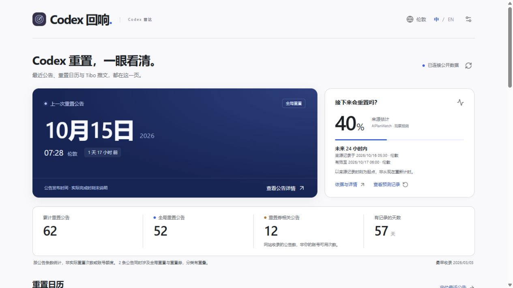
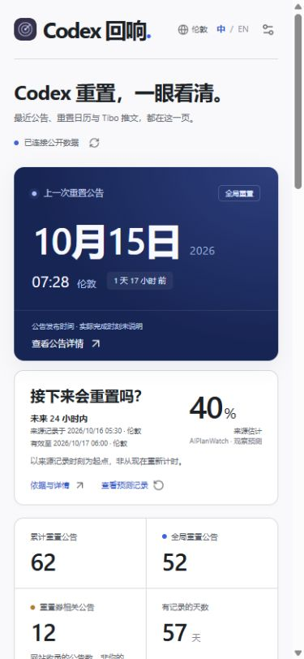

# Codex 回响 · Codex Echo

**简体中文** | [English](README.en.md)

一个简洁的 **Codex 重置公告与预测雷达**：最近一次重置公告、历史日历、Tibo 已收录推文，以及 **Bark iPhone 锁屏提醒**。

**[打开网页](https://echo-radar.pages.dev/) · [iPhone 接入 Bark 教程](docs/BARK_SETUP.md)**

## 网页预览

以下为公开网页的实际截图；日期、数量和预测值只是截图时的快照，以网页当前显示为准。



<details>
<summary>查看手机端</summary>



</details>

<details>
<summary>查看重置计划状态示例（模拟数据）</summary>

**这是本地模拟效果，不是真实重置预告，也不表示目前确定五小时后重置。** 来源明确公布计划后，首页会显示倒计时，并保留最近一次公告。


</details>

## 推荐：网页绑定 Bark

1. iPhone 安装 **Bark**，允许锁屏通知。
2. 复制 Bark 应用中的推送地址。
3. 打开网页，向下滑到 **「手机云端提醒」**，粘贴地址，选择提醒类型、阈值和语言，点击 **「绑定并保存」**。
4. 点击 **「发送测试通知」**，关闭网页并锁屏，确认手机收到。

无需 GitHub 账号、下载代码或购买服务器。完整教程包含每步入口、填写示例、保存与退订方法，以及“Bark 有记录但锁屏没显示”的排查。

| 提醒方式 | 使用要求 |
|---|---|
| **Bark 云端提醒（推荐）** | 绑定自己的 Bark 后，关闭网页仍可由云端发送；手机需允许通知 |
| 页面提醒 | **必须保持页面开启并运行**；关闭页面后停止，切后台或锁屏也可能暂停 |

两处设置相互独立。想关闭网页后收提醒，请使用 Bark。当前网页免费试运行最多 30 台设备，每台每天最多 20 次发送尝试，几位朋友使用不需要扩容。

<details>
<summary>可选：自己在 GitHub 运行 Bark 提醒程序</summary>

## GitHub 自助版：只需一个必填配置

1. 登录 GitHub，点击本页上方 **Use this template → Create a new repository**，在自己的账号创建公开仓库，只复制默认分支。
2. 在自己的仓库打开 **Settings → Secrets and variables → Actions → Secrets → New repository secret**。
3. Name 填 `BARK_DEVICE_KEY`，Secret 粘贴从 Bark 复制的推送地址，点击 **Add secret**。
4. 打开 **Actions → Personal Bark alerts → Run workflow**，勾选测试通知后运行，在 iPhone 锁屏确认收到。

**[GitHub 自助配置详细教程](docs/GITHUB_BARK.md)** 包含逐步点击路径、填写示例、完成标志和排错方法。它独立执行个人推送，不占用网页订阅名额。同一手机建议二选一，避免重复提醒。

默认开启重置和预测提醒，预测阈值 60%，中文推送。需要修改时，在自己仓库的 **Variables** 添加：

| 名称 | 作用 | 默认值 |
|---|---|---|
| `BARK_RESET_ALERTS` | 重置公告：`true` 开 / `false` 关 | `true` |
| `BARK_FORECAST_ALERTS` | 来源预测：`true` 开 / `false` 关 | `true` |
| `BARK_THRESHOLD` | 40–90，每档 5，不带 `%` | `60` |
| `BARK_LANGUAGE` | `zh` 中文 / `en` 英文 | `zh` |
| `BARK_DAILY_LIMIT` | 每个 UTC 日期最多尝试次数，1–20 | `20` |
| `BARK_ENABLED` | 总开关，`false` 暂停 | `true` |

</details>

## 功能与运行

- 单页查看最近公告、按发布日期标记的日历、统计、推文全文与出处；页面和推送支持中英文。
- GitHub 工作流计划每 10 分钟读取共享公开数据，首次建立基线，不补发旧消息。
- 密钥只填 GitHub **Secret**；状态分支不保存原始密钥。发送前保存去重状态，结果不明不盲目重发。
- 手机推送只使用 **Bark**，无需其他消息服务；没有符合条件的新消息时保持安静。

公开仓库使用标准 GitHub 托管运行器的运行时间目前免费；调度可能延迟，公开仓库连续 60 天没有活动会自动停用定时任务。[费用说明](https://docs.github.com/en/billing/concepts/product-billing/github-actions) · [调度限制](https://docs.github.com/en/actions/reference/workflows-and-actions/events-that-trigger-workflows#schedule)

## 已公布的重置计划

当已核对的 Tibo 原文明确写出精确时间，首页优先显示「来源已公布重置计划」和倒计时，日历用独立标记表示计划日期；最近一次公告仍保留。倒计时以原文发布时间为起点，不以采集时间重新计时。

计划时间到达后显示「等待完成确认」，不会自动宣告完成或增加历史次数。后续明确完成、取消或新计划会更新状态。识别采用保守规则：支持直接陈述的小时/分钟时长、带完整日期的 UTC/GMT 时间；模糊、条件式或不支持的时间表达不会生成倒计时。未确认计划在目标时间超过 24 小时后收起。

Bark 的「重置公告」开关同时控制新计划提醒，消息会写明「已公布重置计划」；预测阈值仅影响预测提醒。计划改变或取消、已过目标时间时，旧的计划推送重试会停止。现有订阅无需重新绑定。开启「重置公告」后，新计划公布提醒一次；后续来源明确确认完成时再提醒一次，同一条消息不会反复提醒。仅到达计划时间不会触发完成提醒，也不代表你的个人账号额度恢复。

## 数据说明

公告条数不是你的账号额度或实际重置次数，发布时间不一定是完成时间。概率来自 AIPlanWatch 的公开来源评估，不是 OpenAI 官方承诺。免费公开来源收录的推文可能存在遗漏。

来源包括 [AIPlanWatch](https://codex-reset.aiplanwatch.com/)、[tokenusage](https://tokenusage.dev/developers)、X 公开嵌入和 [FxEmbed](https://github.com/FxEmbed/FxEmbed)。GitHub 自助版独立执行个人推送，仍读取本项目共享的公开数据服务。各平台额度和可用性可能变化。

<details>
<summary>开发者：源码与本地构建</summary>

普通订阅者可以跳过。网页基于 Vue 3 / uni-app，推送服务使用 Cloudflare Workers 和 Bark。开发需要 Node.js 24+：

```sh
npm ci
npm test
npm run build
```

网页输出在 `dist/build/h5/`。本地开发先运行 `npm run server`，另开终端运行 `npm run dev`。自行部署 Worker 时，复制 `web/wrangler.example.jsonc` 为 `web/wrangler.jsonc`，填写自己的 KV / D1 标识，应用 `web/migrations/` 并单独配置生产密钥。

| 目录 | 用途 |
|---|---|
| `src/` | 网页、中英文和手机布局 |
| `web/` | 公开数据 API、Bark 订阅和队列 |
| `scripts/github-notifier.mjs` | 个人 GitHub Bark 提醒，无额外 npm 依赖 |
| `backend/` | 来源采集与本地开发服务 |
| `tests/` | 数据、时间、阈值、去重与推送测试 |

使用 Vue、uni-app、Cheerio、Lucide 和 Radix Colors；许可见 `licenses/`。自有代码使用 MIT 许可，上游内容遵循各自许可。与 OpenAI、原雷达作者及 Bark 无隶属关系。

</details>
